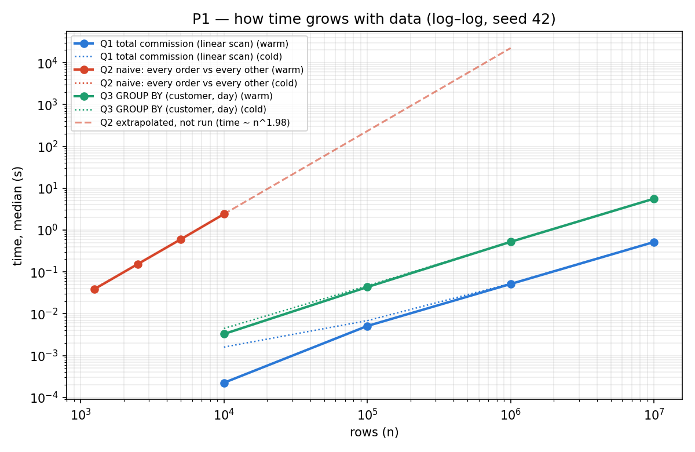

# P1 — The dashboard is empty at 08:00 (in-class lab)

**Student:** Mahmut Eren Akkaymak · **Seed:** 42 · **Datasets:** the four P0 tables, unchanged (not regenerated)  
**Estimate committed before any measurement:** `ESTIMATE_P1.md`, commit `bbc203d`  
**Code:** `p1.py` (queries + run), `measure.py` (helper), `plot_p1.py` (chart) · **Raw output:** `p1_measurements.csv`, `p1_results.md`, `p1_run_log.txt`

## 1. Answer to Sinem

**No — do not approve the bigger server.** The number: Q2's growth factor is **~4× for every 2× of data** (3.94 / 3.93 / 4.00). Doubling the server halves the time once; 60% more data then multiplies a quadratic step by 2.56× every year. Rewriting the same question as a grouping (Q3) gave the **same answer (86 customers) in 0.0033 s instead of 2.41 s — 730× faster** — and it grows linearly (~10–12× per 10×).

**The eleven-hour job in twelve months (volume +60%):**

| Assumption | Today | In 12 months | With a 2× server (best case: time halves) |
| :--- | ---: | ---: | ---: |
| Time grows as fast as the data (linear, Q1/Q3) | 11 h | 11 × 1.6 = **17.6 h** | 8.8 h |
| Time grows much faster (quadratic, Q2: ×1.6²) | 11 h | 11 × 2.56 = **28.2 h** — longer than a day | 14.1 h |

Even in the kind case the server buys less than a year: 8.8 h already misses an 8-hour night window (assumption: job starts ~00:00, must finish by 08:00). In the quadratic case it never catches up. Deniz's "in six months we are at this table again" holds: 11 × 1.6^0.5 ≈ 13.9 h → 7 h on the big server at six months, at the edge of the window.

**Cost of the empty dashboard:** 40 people × 2 h × 350 TL = **28,000 TL per working day ≈ 616,000 TL per month** (22 working days). The server is 95,000 TL/month (1.14 M TL/year).  
**Does it change the answer?** It changes the urgency, not the decision. Waiting costs ~6.5× what the server costs, so the fix must land fast. Finding and rewriting the quadratic step is engineer-days, not 1.14 M TL a year. If that fix cannot be delivered within a month, one month of the large instance (95,000 TL) is a defensible *bridge* — but only with an end date, not as the solution.  
**Assumption I cannot check from the lab:** that the real ETL contains a compare-every-row-with-every-row step like Q2. The case numbers point that way: volume grew ~40% in nine months (1.6^0.75), while the job time grew 83% (6 h → 11 h) — faster than the data, which is what a super-linear step looks like.

## 2. Estimate vs. measurement

| Query | Committed estimate | Measured (warm median) | Verdict |
| :--- | :--- | :--- | :--- |
| Q1 | linear (1×); 10M ≈ 0.55 s cold | factor 10.09× / 10.07× above 100k; 10M = **0.525 s cold**, 0.517 s warm | right (used P0 as prior) |
| Q2 | quadratic, 4× per doubling; 10k ≈ 2 s; 100k ≈ 200 s; 1M ≈ 20,000 s | **3.96× per doubling** (n^1.98); 10k = **2.41 s** | right shape, 20% optimistic on speed |
| Q3 | n log n, ~11–12× per 10×; 10M ≈ 8 s | 13.2× / 12.1× / 10.8×; 10M = **5.62 s** | right shape, 30% pessimistic |

Where I was wrong: I overestimated Q3 at 10M by ~40% (SQLite's sort for GROUP BY is faster than I assumed) and underestimated Q2 by ~20%. The growth *shapes* were right, which is what the decision rests on.

## 3. Measurement table

Three cold runs = three separate fresh Python processes (connect + query). Warm = 5 runs in one process after a discarded priming run. Growth factor = this row's median ÷ previous row's (same query, same run type). "Result" = number of distinct customers found (Q2/Q3) or total commission in TL (Q1).

| Method | n | Time (median, s) | Min-Max | Time/n (us) | Run | Growth factor | Result |
| --- | ---: | ---: | ---: | ---: | --- | ---: | ---: |
| Q1 commission (SUM) | 10,000 | 0.001595 | 0.001589-0.006869 | 0.1595 | cold | — | 652,338.91 |
| Q1 commission (SUM) | 10,000 | 0.000224 | 0.000222-0.000257 | 0.0224 | warm | — | 652,338.91 |
| Q1 commission (SUM) | 100,000 | 0.006828 | 0.006659-0.006888 | 0.0683 | cold | 4.28x | 6,523,716.91 |
| Q1 commission (SUM) | 100,000 | 0.005089 | 0.005015-0.005196 | 0.0509 | warm | 22.72x | 6,523,716.91 |
| Q1 commission (SUM) | 1,000,000 | 0.052800 | 0.052379-0.053009 | 0.0528 | cold | 7.73x | 65,239,838.94 |
| Q1 commission (SUM) | 1,000,000 | 0.051327 | 0.050841-0.051851 | 0.0513 | warm | 10.09x | 65,239,838.94 |
| Q1 commission (SUM) | 10,000,000 | 0.524765 | 0.524656-0.881779 | 0.0525 | cold | 9.94x | 652,698,511.95 |
| Q1 commission (SUM) | 10,000,000 | 0.517021 | 0.514183-0.519534 | 0.0517 | warm | 10.07x | 652,698,511.95 |
| Q2 naive (compare) | 1,250 | 0.040202 | 0.039438-0.040475 | 32.1617 | cold | — | 0 |
| Q2 naive (compare) | 1,250 | 0.038873 | 0.038639-0.039978 | 31.0983 | warm | — | 0 |
| Q2 naive (compare) | 2,500 | 0.153870 | 0.153366-0.154389 | 61.5479 | cold | 3.83x | 4 |
| Q2 naive (compare) | 2,500 | 0.153068 | 0.151384-0.153651 | 61.2271 | warm | 3.94x | 4 |
| Q2 naive (compare) | 5,000 | 0.609019 | 0.607520-0.609410 | 121.8038 | cold | 3.96x | 22 |
| Q2 naive (compare) | 5,000 | 0.601441 | 0.596532-0.604463 | 120.2883 | warm | 3.93x | 22 |
| Q2 naive (compare) | 10,000 | 2.401292 | 2.398941-2.403756 | 240.1292 | cold | 3.94x | 86 |
| Q2 naive (compare) | 10,000 | 2.406346 | 2.403529-2.413592 | 240.6346 | warm | 4.00x | 86 |
| Q3 grouping (GROUP BY) | 10,000 | 0.004452 | 0.004371-0.004529 | 0.4452 | cold | — | 86 |
| Q3 grouping (GROUP BY) | 10,000 | 0.003276 | 0.003198-0.003373 | 0.3276 | warm | — | 86 |
| Q3 grouping (GROUP BY) | 100,000 | 0.046511 | 0.044664-0.046996 | 0.4651 | cold | 10.45x | 829 |
| Q3 grouping (GROUP BY) | 100,000 | 0.043328 | 0.042657-0.045344 | 0.4333 | warm | 13.22x | 829 |
| Q3 grouping (GROUP BY) | 1,000,000 | 0.524812 | 0.518858-0.526816 | 0.5248 | cold | 11.28x | 8,167 |
| Q3 grouping (GROUP BY) | 1,000,000 | 0.522411 | 0.517594-0.528122 | 0.5224 | warm | 12.06x | 8,167 |
| Q3 grouping (GROUP BY) | 10,000,000 | 5.634555 | 5.591244-5.819835 | 0.5635 | cold | 10.74x | 82,751 |
| Q3 grouping (GROUP BY) | 10,000,000 | 5.617439 | 5.600640-5.622080 | 0.5617 | warm | 10.75x | 82,751 |

**Q2 = Q3 check** (Q3 re-run on the same first-N rows of `Orders_10k`): 1,250 → 0 = 0 · 2,500 → 4 = 4 · 5,000 → 22 = 22 · 10,000 → 86 = 86. Identical at every size.

**Q2 extrapolated, not run:** geometric mean 3.96× per doubling → time ∝ n^1.98. From 2.41 s at 10,000: **100,000 rows ≈ 232 s (~4 min); 1,000,000 rows ≈ 22,350 s (~6.2 h)**. For comparison Q3 does 10,000,000 rows in 5.6 s. Not running the 1M case is the answer: 6 hours to confirm a number the pattern already gives.

**Things the table shows that I did not expect:**
- Q1 cold at 10k is 7× warm (1.6 ms vs 0.22 ms): at small n the process start-up / first file open dominates. From 1M up cold ≈ warm, because Windows keeps the 482 MB file in its file cache between processes (96 GB RAM). A truly disk-cold run would need the OS cache flushed — not possible from a normal user session; stated as a limitation.
- Q1 10M cold max is 0.88 s vs median 0.52 s: one of three cold processes was 1.7× slower. With 3 runs I cannot tell whether that is noise or a real first-touch cost; the median is robust to it.
- Q1 warm 10k→100k is again ~22× (as in P0): the 10k table fits in SQLite's ~2 MB page cache, the 100k table does not.

## 4. Chart

Log–log: a straight line's slope is the exponent. Q1 and Q3 have slope ≈ 1; Q2 has slope ≈ 2. On the right edge, Q2 extrapolated to 1M rows sits above Q3 at 10M rows by more than three orders of magnitude.

## 5. How the naive query was kept naive

Q2 is a self-join on (customer_id, order_date) with `a.seller_id <> b.seller_id`. SQLite would normally build a temporary **automatic index** for such a join, which silently turns the "naive" query into a fast one. I switched it off (`PRAGMA automatic_index = OFF`) and checked `EXPLAIN QUERY PLAN`: `SEARCH a USING INTEGER PRIMARY KEY (rowid<?)` / `SEARCH b USING INTEGER PRIMARY KEY (rowid<?)` — for every row of `a`, all N rows of `b` are scanned. The measured 4× per doubling confirms it.

## 6. The AI box

- **What I asked the model:** to write the naive and the grouped versions of Q2/Q3, and to extend `measure()` with a growth-factor column, the query result, and true cold runs.
- **Where it was wrong / would have been wrong:** (1) the first version of the "naive" query was a plain SQL self-join — SQLite's automatic index would have made it fast, so the "naive" measurement would not have been naive; (2) it initially framed the output as "pairs of orders with different sellers", not **distinct customers**, which is what the card asks for; (3) for P0 it had defined cold as a new connection in the same process, which the P1 card's definition rules out.
- **How I found out:** (1) `EXPLAIN QUERY PLAN` and the 4× growth factor; (2) by re-reading the card ("one number: how many distinct customers") and requiring Q2 = Q3 at every prefix; (3) by comparing P0's cold ≈ warm numbers with the P1 definition of cold.

---
*Environment: AMD Ryzen 9 9950X3D (16C/32T), 96 GB DDR5, NVMe SSD · Windows 11 Pro 10.0.26200 · Python 3.11.9 · sqlite3 module 2.6.0, SQLite engine 3.45.1 · matplotlib (chart only) · seed 42*
